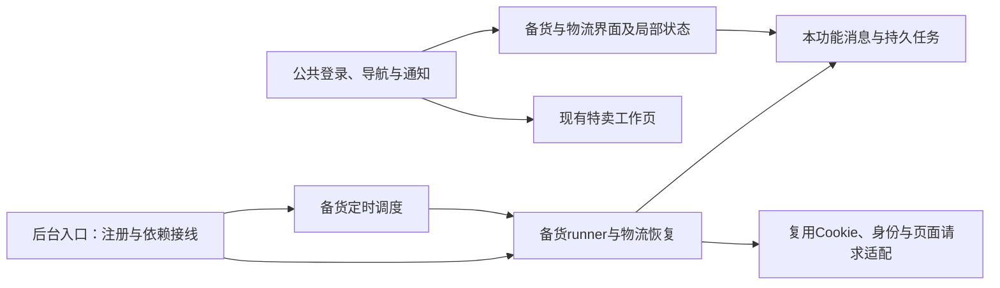

# 现项目模块解耦审查

日期：2026-10-14。角色：Codex 规划／独立审查。对象：本目录当前工作树，分支`main`、提交`0b5f755`、源码版本1.15.2。先完成客户插件功能调查及迁移书，再进行本审查；未改产品代码／重跑产品测试／构建／启动服务。

## 1. 结论

**近期新增的弹窗、管理网站和后台修复已有实质模块分离；整个扩展核心仍有中等偏高的耦合。** 特卖公共状态、完整工作页面、后台路由／调度仍集中，当前首页仅支持特卖，不是加入一条卡片即可接通新业务。该判断不推翻已通过用户体验，属于新增工具时的维护风险，未复现新的产品故障。

下一轮备货／物流应采用独立状态、请求／规则、任务、runner和调度模块，首页和后台只做必要接入。先建立新功能的分离结构，不要求先全仓重构旧特卖；旧核心的深度拆分另行规划。

## 2. 检查方法与范围

静态读取76个产品JS/TS/TSX文件：`entrypoints/`、`components/`、`backend/src/`、`admin-web/src/`。使用本机TypeScript解析器提取导入关系（处理`@/`、相对路径及NodeNext `.js`→`.ts`），检查实际调用、共享状态、消息、storage／alarm与最近两个功能提交。没有执行这些模块的业务代码。

数据在[模块清单与导入图](../../artifacts/agent/feature-migration-20261014/target-module-inventory.json)。静态图未发现内部导入循环；这不证明没有运行时／storage／消息耦合，动态加载和构建打包不在本轮验证范围。行数只辅助找阅读重点，结论来自职责和调用关系，不设机械行数通过标准。

## 3. 已经分离的部分

| 功能 | 已观察的模块与接口 | 评价 |
| --- | --- | --- |
| 弹窗策略 | `PopupPolicyHost`展示；`popup-policy`读取／缓存／版本；`popup-content`清洗；`popup-views`上报 | 分工明确；策略模块不依赖React/store，上报独立超时；与原后台worker执行算法分离 |
| 弹窗后端／管理 | `routes/popup`路由、`utils/popup-policy`验证、`utils/popup-views`统计；管理`PopupPage`、编辑器／明细／版本指引、`api/popup` | 同功能内部协作集中；管理网站独立目录／依赖／构建，扩展不导入管理编辑器。数据库和auth为有意共享，不因此称耦合错误 |
| 一键修复 | `one-day-sku`纯构造；`one-day-sku-task`契约／纯状态决策；`one-day-sku-runner`执行 | runner依赖显式`RepairRunnerDeps`，不import React/Zustand/DOM，任务key和终态有独立定义；可以保留、复用设计，不要拷进新store |
| 首页 | `FeatureHome`展示、`feature-catalog`定义、`task-summary`纯摘要 | 展示模块已分离且采用回调；目录当前只注册特卖，控制层仍需适配新工具 |
| 自有后端 | Hono入口挂auth/stores/analytics/admin/popup等独立routes | 入口主要是组合，职责比扩展后台集中程度低；新管理能力沿用当前分层 |

最近弹窗结案提交显示`App.tsx`只做少量宿主接线，核心新增在独立模块，`background.ts`没有加入通知执行逻辑。后台修复提交新增独立runner／task，但也在`background.ts`加了启动、身份、存储、心跳和互斥适配；模块分离存在，后台入口尚未保持足够薄。

## 4. 具体集中点与新增功能的影响

### D1：公共store承载多种职责——耦合高

`entrypoints/popup/store.ts`约3664行，76文件静态图中有16个内部导入者。`AppState/useAppStore`同时含Cookie／连接、登录／绑定、特卖商品／SKU、复制、模板、自动模式、首次使用、修复结果；`reset`同时重置多类状态，`setupBackgroundListener`集中更新多类任务。

证据：`App`、`AuthPanel`、`StoreStatus`、`AutoModePanel`、`SkuTable`、模板／复制／首次使用组件依赖同一store，多处以无selector的`useAppStore()`订阅整个状态；`App`直接调用`useAppStore.setState`改SKU／向导字段。改一个领域容易影响重置、持久化和监听的其他领域；本轮不据此断言已经发生性能问题。

建议：shipping拥有自己的store与任务状态；公共登录／当前身份通过窄接口只读复用。既有特卖store维持原样，按具体需求再抽公共session；不为了“统一”把shipping参数继续塞进AppState。

### D2：App同时做外壳、初始化和整个特卖工作页——耦合高

`entrypoints/popup/App.tsx`约2096行、25个导入项。`App`除了公共登录／绑定门控、通知宿主、导航，还包含完整特卖向导、多个弹层、SKU覆盖编辑和复制／自动状态恢复。`page`类型仅`home|flash-sale`；`enterFeature`拒绝其他featureId；`viewTask`一律先导航特卖。初始化就等待所有特卖状态读取后设`taskStatusReady`。

影响：仅加目录卡片不会打开新工具；若把shipping继续加进该初始化／JSX，任何工具都更依赖特卖加载和局部字段。

建议：shipping视图单独组件；外壳导航显式识别新入口和任务所属工具，状态恢复按功能进行。必要时在此次接入中提取最小特卖工作视图，保留现有“返回首页只隐藏、不卸载草稿”契约；不能为新功能默默重置旧草稿或提前移走登录门控。

### D3：后台入口仍是多业务实现集——耦合高

`entrypoints/background.ts`约3507行，内含`runEnableLoop`、`executeScheduledCopyFlow`、自动模式全部调度、Cookie／注入／后端鉴权、修复启动和结果适配、整段`runtime.onMessage`与`alarms.onAlarm`。共享`_enableParams/_enableProgress/_autoModeStatus`和多种内存运行标记；`findActiveRepairConflict/findSameShopWriteConflict`只认识既有特卖／复制／修复任务。

影响：新增shipping写入若没有双方接入互斥，修复和改备货可能同时改同一商品；仅创建独立文件不能消除这种运行时冲突。若停止／alarm清理复用旧键名，则可能停止旧特卖。

建议：新shipping模块暴露小接口，如注册消息、处理自己的alarm、查询占用／状态；入口传入现有Cookie／注入／身份依赖，模块定义专属storage／alarm／请求标识。双方写入口复用必要占用检查，忙态拒绝新手动动作／按明确规则等待计划；没有必要先建设通用任务中心或改写全部旧任务。

### D4：请求与商品查询存在多套实现——耦合中等

`store.ts`和`background.ts`分别有`injectedFetch`、商品GraphQL常量和不同标签页选择方式；`popup/api.ts`也有GraphQL实现，但本次产品静态图没有其内部导入者。popup请求要求当前活动卖家页，后台请求可寻找任意卖家页，是实际差异，不能机械合并函数而改变调用上下文。

建议：shipping从后台注入适配器接收请求能力；REST `status=1/8`与特卖GraphQL `status=0`分开解码。不得因`api.ts`文件名就假定它是现在被调用的共享网络入口，也不删除已有未用代码。以后同类缺陷确需共修时再抽共享transport／响应校验。

### D5：共享类型和首页任务摘要仍以特卖为中心——耦合中等

`popup/types.ts`约551行、19个内部导入者，覆盖现有账号／特卖／修复共享契约。`TaskSummaryKind`与`TaskSummaryInput`只表达特卖相关任务；`feature-catalog`虽有稳定featureId和entry，但真正分发由App硬编码。

建议：shared跨运行环境消息契约只保留一份；shipping内部类型、状态和摘要转换各归模块。首页摘要带工具来源以导航，简单显式组合即可，不引入未请求的动态插件加载框架。手册09当前“全部类型集中／store动作内联”应在新增功能任务内限定为“共享契约单一来源／各功能store内联”，避免开发者为遵守旧字面要求加重全局store。

### D6：一处代码地图已过时——资料已定向修正

手册03仍写`PopupPolicyHost`在main最外层包整个App；实际`main.tsx`只渲染App，`App`在登录／首次就绪后的return挂宿主，手册07已正确描述。若新功能照旧地图接线，会把通知重新压在登录表单。本轮只修正该地图一句，规则和源码行为未变。

## 5. 下一轮开发应遵守的最小结构

功能实现放`features/shipping/`，UI放`components/product/shipping/`；具体拆文件按职责和真实复用决定。后台runner不依赖React／Zustand／DOM；调度只触发runner，不重复写备货算法；UI只读持久状态、发启动／停止；店铺物流恢复结果和商品结果分别可见。新功能不能复用旧特卖任务storage键或清除其alarm。

验收结构时看实际影响：修改shipping规则无需改特卖算法；停止shipping不停止特卖；新增任务展示不会要求每个工具读取特卖局部状态；接口失败可以从当前功能的脱敏结果定位。无需用“每文件多少行”代替这些条件。

## 6. 本轮完成范围

功能迁移书和接口参考已交付，当前选定M02.1尚未编码。结构审查已有具体证据和接入建议，**解耦建议尚未实施**；旧功能用户确认继续有效，无新返工单。正式派开发时，把当前选定范围和S1–S6细化成任务书并赋予上述文件写权；开发交回后才核查实际分离和完整链路。

本轮只写文档／小型静态证据，产品文件hash保持一致；没有浏览器、数据库或构建产物。源码来源快照和AST图保留在`artifacts/agent/feature-migration-20261014/`，一次性脚本收尾清理，未操作历史审批拒绝目录和他人文件。
